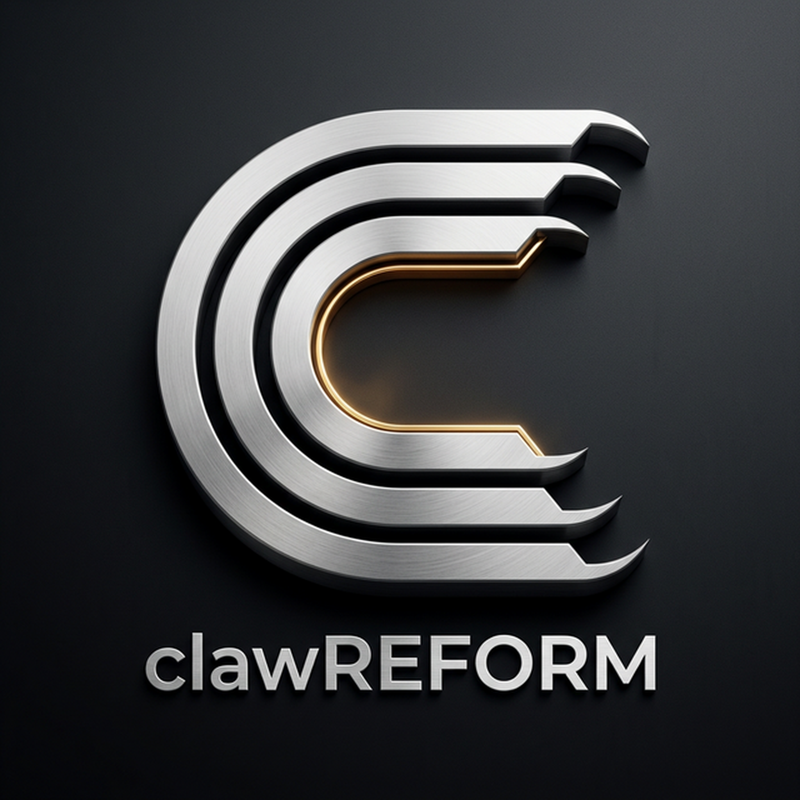
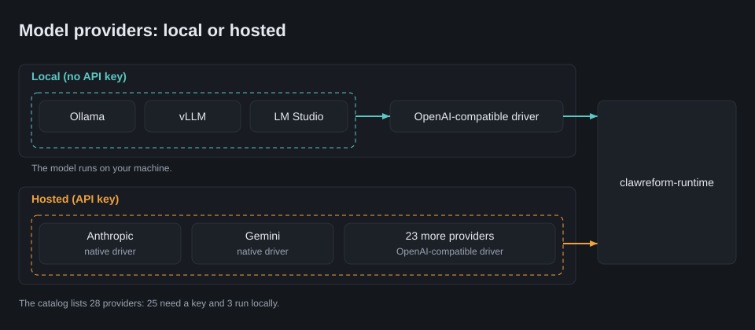
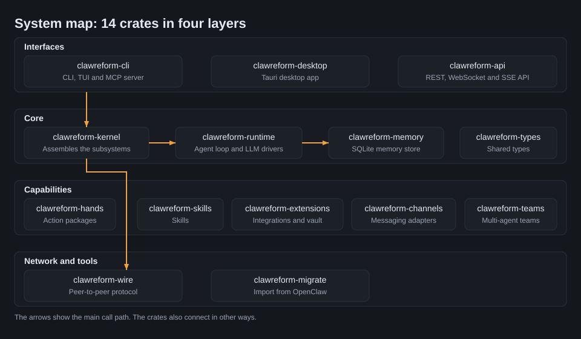
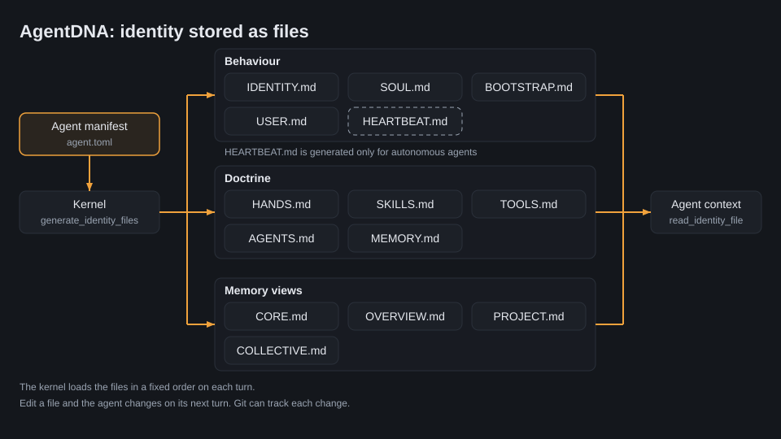
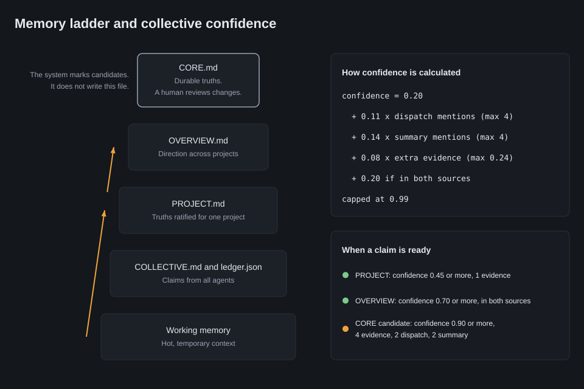
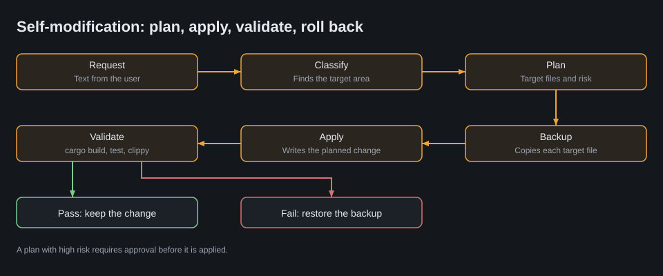

<p align="center">
  
</p>

<h1 align="center"><code>claw</code><strong>REFORM</strong></h1>

<h3 align="center">An open-source operating system for AI agents, written in Rust</h3>

<p align="center">
  <a href="https://github.com/aegntic/clawreform"></a>
  
  
  <a href="https://github.com/aegntic/clawreform/actions/workflows/ci.yml"></a>
</p>

<p align="center">
  <a href="https://clawreform.com">Website</a> •
  <a href="https://clawreform.com/docs">Docs</a> •
  <a href="https://x.com/clawreform">X</a> •
  <a href="https://skool.com/autoclaw">Community</a> •
  <a href="https://github.com/aegntic/clawreform/issues">Issues</a>
</p>

---

<!-- SEO: AI agent OS, multi-agent orchestration, Rust AI framework, autonomous agents, LLM orchestration, MCP server, agent operating system, OpenClaw alternative, multi-agent swarm, agentic AI, agent runtime, clawREFORM -->

## Install

clawREFORM runs on Linux, macOS and Windows. You do not need Rust to install it.

### Step 1. Install the binary

**Linux and macOS**

```bash
curl -fsSL https://get.clawreform.com | sh
```

**Windows (PowerShell)**

```powershell
irm https://get.clawreform.com/install.ps1 | iex
```

**npm**

```bash
npm install -g clawreform
```

**Docker**

```bash
docker pull ghcr.io/aegntic/clawreform:latest
```

The install script downloads the latest release. It verifies the SHA-256 checksum. It puts `clawreform` in `~/.clawreform/bin` and adds that directory to your PATH. For more methods, see [Getting started](docs/getting-started.md).

### Step 2. Start the daemon

```bash
clawreform init
```

`clawreform init` creates `~/.clawreform/` and a default configuration file.

```bash
clawreform start
```

The daemon listens on `http://127.0.0.1:4332`. The web dashboard is at that address.

### Step 3. Talk to an agent

```bash
clawreform chat "Summarise this repository"
```

To check your setup, run:

```bash
clawreform doctor
```

## Use a local model

You do not need an API key. Ollama, vLLM and LM Studio run a model on your machine.

1. Install Ollama from [ollama.com](https://ollama.com).
2. Pull a model: `ollama pull llama3.2`.
3. Start the server: `ollama serve`.
4. Set the provider in `~/.clawreform/config.toml`:

```toml
[default_model]
provider = "ollama"
model = "llama3.2"
api_key_env = "OLLAMA_API_KEY"
```



The catalog lists 28 providers. 25 providers need an API key. 3 providers run locally: Ollama, vLLM and LM Studio. clawREFORM has three drivers: Anthropic, Gemini and OpenAI-compatible. See [Providers](docs/providers.md).

A feature that calls an external service needs a network connection. Examples are a hosted model, a web search and a messaging channel.

## What you get

| | |
|---|---|
| Crates | 14 Rust crates in one workspace |
| Agent templates | 30 in [`agents/`](agents) |
| Model providers | 28: 25 hosted and 3 local |
| Models in the catalog | more than 140 |
| Skills | 62 bundled |
| Hands | 7 bundled action packages |
| Messaging channels | Telegram, Discord, Slack, WhatsApp, Signal, Matrix and more |
| Interfaces | CLI, TUI, web dashboard, REST API, WebSocket, SSE, MCP server |
| Tests | more than 1,800. CI runs them on Linux, macOS and Windows. |

clawREFORM is one binary. The core binary does not need Python or Node.js. Some optional skills use Python. clawREFORM stores its data in SQLite.

## How it works

### The system map



| Crate | Function |
|---|---|
| `clawreform-types` | Shared types and the model catalog |
| `clawreform-memory` | Memory store on SQLite |
| `clawreform-runtime` | Agent loop, model drivers, tools, WebAssembly sandbox |
| `clawreform-kernel` | Connects the subsystems: workflows, permissions, schedules |
| `clawreform-hands` | Action packages |
| `clawreform-skills` | Skills |
| `clawreform-extensions` | Integrations and the credential vault |
| `clawreform-channels` | Messaging adapters |
| `clawreform-teams` | Teams of agents that share a workspace |
| `clawreform-wire` | Peer-to-peer protocol between clawREFORM nodes |
| `clawreform-api` | REST, WebSocket and SSE API, and the web dashboard |
| `clawreform-cli` | Command line interface, TUI and MCP server |
| `clawreform-desktop` | Desktop app (Tauri) |
| `clawreform-migrate` | Imports agents from OpenClaw |

### AgentDNA: identity stored in files

Each agent has a workspace. The workspace contains Markdown files. Each file controls one part of the agent.



| Group | Files | Function |
|---|---|---|
| Behaviour | `IDENTITY.md`, `SOUL.md`, `BOOTSTRAP.md`, `USER.md`, `HEARTBEAT.md` | Who the agent is and how it acts |
| Doctrine | `HANDS.md`, `SKILLS.md`, `TOOLS.md`, `AGENTS.md`, `MEMORY.md` | What the agent may do and how it works |
| Memory views | `CORE.md`, `OVERVIEW.md`, `PROJECT.md`, `COLLECTIVE.md` | What the agent remembers |

- The kernel creates these files when you spawn an agent. It creates `HEARTBEAT.md` only for an autonomous agent.
- On each turn, the kernel reads the files in a fixed order. It adds their content to the context of the model.
- When you change a file, the agent changes on its next turn. You do not compile or deploy again.
- Git can track each change.

The code is in [`generate_identity_files`](crates/clawreform-kernel/src/kernel.rs#L280) and [`read_identity_file`](crates/clawreform-kernel/src/kernel.rs#L1202). For more detail, see [AgentDNA system](docs/agentdna-system.md).

### Memory: four tiers and a confidence score

clawREFORM keeps the memory of an agent in four tiers. Temporary context stays at the bottom. Durable truths are at the top.



| Tier | File | Content |
|---|---|---|
| Collective | `COLLECTIVE.md`, `memory/collective/ledger.json` | Claims from all agents in the workspace |
| Project | `PROJECT.md` | Truths ratified for one project |
| Overview | `OVERVIEW.md` | Direction across projects |
| Core | `CORE.md` | Durable truths. A person reviews the changes. |

Agents write dispatch notes and session summaries. A dispatch note is a note that one agent sends to the other agents. clawREFORM groups equal notes into one claim. It calculates a confidence value for each claim:

```text
confidence = 0.20
           + 0.11 x dispatch mentions    (maximum 4 mentions)
           + 0.14 x summary mentions     (maximum 4 mentions)
           + 0.08 x additional evidence  (maximum 0.24)
           + 0.20 if the claim is in a dispatch note and in a summary
           (the maximum value is 0.99)
```

| clawREFORM uses the claim | When |
|---|---|
| In `PROJECT.md` | The confidence is 0.45 or more, and the claim has 1 or more items of evidence. |
| In `OVERVIEW.md` | The confidence is 0.70 or more, and the claim is in both sources. |
| As a core candidate | The confidence is 0.90 or more, and the claim has 4 items of evidence, 2 dispatch mentions and 2 summary mentions. |

- clawREFORM writes the claims into the "Auto Snapshot" section of `PROJECT.md` and `OVERVIEW.md`. You can write your own notes in the "Human Notes" section.
- clawREFORM does not write `CORE.md`. It marks a claim as a core candidate in the ledger. A person reviews the candidate.
- The confidence of a memory decreases with time.

The code is in [`build_collective_ledger`](crates/clawreform-kernel/src/kernel.rs#L888). The test [`test_collective_conscience_promotes_claims_across_layers`](crates/clawreform-kernel/src/kernel.rs#L5856) verifies the behaviour.

### Self-modification

The self-modification module changes the files of the clawREFORM source code. It is experimental.



1. You describe the change in text.
2. clawREFORM classifies the request and selects the target files.
3. clawREFORM copies each target file to a backup.
4. clawREFORM applies the change to the files.
5. clawREFORM runs `cargo build`, `cargo test` and `cargo clippy`.
6. If a step fails, clawREFORM restores the backup.

A plan with high risk requires approval before clawREFORM applies it.

**Status.** These parts are implemented: classification, plan, backup, validation and rollback. These parts are not implemented: generation of code by a model, analysis of the syntax tree, and a Git commit. The module has no tests.

**CAUTION:** The module writes to your source files. Use it on a copy of the repository.

The code is in [`clawreform-kernel/src/self_modify/`](crates/clawreform-kernel/src/self_modify/mod.rs).

### Security

- An agent can use only the capabilities that its manifest permits.
- The roles are Owner, Admin, User and Viewer.
- clawREFORM signs agent manifests with Ed25519.
- Nodes authenticate each other with HMAC-SHA256.
- clawREFORM runs untrusted code in a WebAssembly sandbox with limits on fuel and time.
- An audit log records the actions of agents in a hash chain. You can verify the chain at `/api/audit/verify`.

See [SECURITY.md](SECURITY.md) and the [security reference](docs/security.md).

## Connect to other software

| Standard | What clawREFORM does |
|---|---|
| OpenAI API | clawREFORM serves `/v1/chat/completions`. OpenAI clients can connect to it. |
| MCP (Model Context Protocol) | clawREFORM is a client and a server. |
| A2A (agent-to-agent) | clawREFORM is a client and a server. |
| OpenClaw configuration | `clawreform migrate --from openclaw` imports agents from OpenClaw. |
| Prometheus | clawREFORM serves metrics at `/api/metrics`. |

## Design decisions

| Decision | Reason |
|---|---|
| Rust, one binary | The binary runs on Linux, macOS and Windows. It does not need an interpreter. |
| Files for identity | You can read, compare and review the files of an agent in Git. |
| Tiers for memory | Temporary notes and durable truths stay separate. |
| WebAssembly sandbox | Untrusted code runs with limits on fuel and time. |
| SQLite | The data is in one file on your machine. You do not operate a database server. |

## Develop

You need Rust 1.75 or later.

```bash
git clone https://github.com/aegntic/clawreform.git
cd clawreform
cargo build --workspace
cargo test --workspace
```

CI rejects code that is not formatted. CI also rejects code with a Clippy warning. Run these commands before you make a pull request:

```bash
cargo fmt --all
cargo clippy --workspace --all-targets -- -D warnings
```

Read [CONTRIBUTING.md](CONTRIBUTING.md).

The source has approximately 150,000 lines of Rust.

| Directory | Content |
|---|---|
| `crates/` | The 14 Rust crates |
| `agents/` | 30 agent templates |
| `docs/` | Documentation |
| `sdk/` | Python and TypeScript SDKs |
| `extensions/` | Browser extensions |
| `packages/` | npm packages |
| `infra/` | The Cloudflare Worker for `get.clawreform.com` |

## Documentation

| Guide | Content |
|---|---|
| [Getting started](docs/getting-started.md) | Install, configure and talk to an agent |
| [AgentDNA system](docs/agentdna-system.md) | Design an agent with files |
| [Architecture](docs/architecture.md) | The crates in detail |
| [Providers](docs/providers.md) | Configure a model provider |
| [Security](docs/security.md) | Security reference |
| [API reference](docs/api-reference.md) | HTTP, WebSocket and SSE endpoints |
| [Channel adapters](docs/channel-adapters.md) | Messaging channels |
| [Workflows](docs/workflows.md) | Chains of agents |
| [CLI reference](docs/cli-reference.md) | Commands |
| [Configuration](docs/configuration.md) | Configuration fields |
| [Troubleshooting](docs/troubleshooting.md) | Problems and questions |
| [Index of all documents](docs/README.md) | All documents in `docs/` |

## Community

- Report a bug or ask a question: [GitHub Issues](https://github.com/aegntic/clawreform/issues).
- Community: [Skool](https://skool.com/autoclaw).
- News: [X](https://x.com/clawreform).
- Report a vulnerability in private: see [SECURITY.md](SECURITY.md).

## License

You can use clawREFORM under the [MIT license](LICENSE-MIT) or the [Apache License 2.0](LICENSE-APACHE).

clawREFORM started as a fork of ClawReForm v0.1.9. See [CHANGELOG.md](CHANGELOG.md).

---

<p align="center">
  <strong>Built by <a href="https://aegntic.ai">aegntic.ai research</a> for <a href="https://ae.ltd">ae.ltd</a></strong>
</p>
